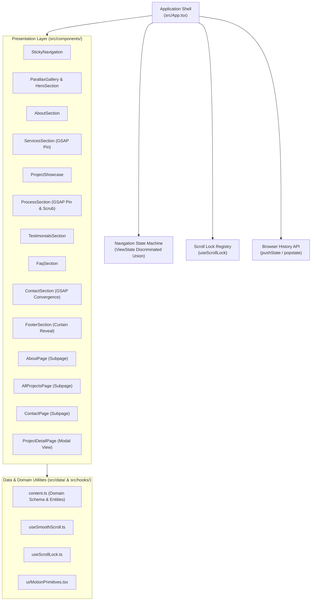

# System Architecture: OFST

## Overview
OFST is an editorial, minimalist design studio portfolio built on React 19, Tailwind CSS v4, GSAP, Framer Motion, and Lenis smooth scrolling.

## System Topology & Layers

The system follows a strict 3-tier layering model:

## Key Architectural Decisions

1. **Deterministic State Routing (ADR-001)**:
   - Replaced multi-variable boolean flags with a single discriminated union `ViewState`.
   - Guaranteed exhaustive pattern matching prevents invalid overlapping states.

2. **Reference-Counted Scroll Management (ADR-002)**:
   - Centralized in `src/hooks/useScrollLock.ts`.
   - Prevents scroll un-locking race conditions when closing nested overlays or modal transitions.

3. **Motion Performance & Frame Budget (Zero-Jank)**:
   - All interactive and scroll-linked animations animate composite properties only (`transform`, `opacity`).
   - Forced reflow is eliminated by avoiding animated CSS `width`, `height`, or layout properties.
   - Pinned GSAP ScrollTriggers manage explicit `trigger` targets and clean up deterministically on unmount.

4. **Asset Splitting & Production Bundling**:
   - Function-based `manualChunks` in `vite.config.ts` segments React runtime, Framer Motion + Lenis, and GSAP into independent, cacheable vendor chunks.
